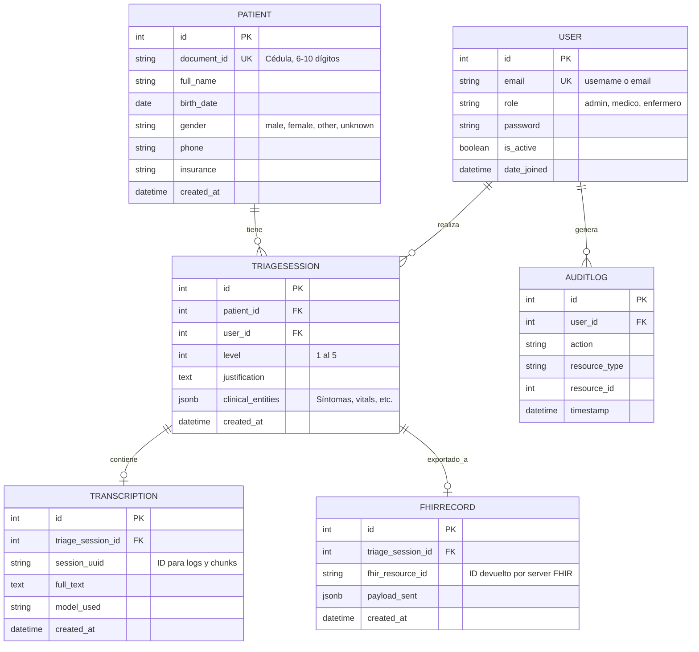

# Modelo de Datos Propuesto

## 1. Diagrama de Entidad-Relación (Mermaid)

## 2. Descripción y Justificación de las Relaciones

1. **User (Usuario del Sistema)**:
   - Representa al personal médico. Se usa email/cédula como llave principal de acceso. Reemplaza al `User` por defecto de Django para poder tener un rol (`role`).
2. **Patient (Paciente)**:
   - Contiene la información demográfica. `document_id` es único para evitar duplicados en la base de datos (restricción explícita solicitada).
3. **TriageSession (Sesión de Triaje)**:
   - Entidad central. 
   - *FK a User*: Para saber quién realizó el triaje.
   - *FK a Patient*: Para vincular el triaje a un paciente específico.
   - Contiene el nivel (1-5) y el JSON de `clinical_entities` arrojado por Gemini.
4. **Transcription (Transcripción)**:
   - *FK a TriageSession*: Todo triaje se basa en una transcripción. Permite guardar la transcripción y el UUID usado en `whisper_engine.py`.
5. **FHIRRecord (Registro FHIR)**:
   - *FK a TriageSession*: Registra el mapeo exitoso de la sesión hacia el estándar HL7/FHIR, guardando el ID remoto para trazabilidad clínica.
6. **AuditLog (Log de Auditoría)**:
   - *FK a User*: Para registrar quién hizo una consulta sensible (ej. acceder a un paciente crítico, modificar un resultado). Requisito para sistemas de salud.
