# Modelo de Datos Implementado (AI-Triage)

**Fecha de Actualización:** 2026-10-27  
**Motor de Persistencia:** PostgreSQL 16 con extensión `pgvector` (Producción) / SQLite en memoria (Suite de pruebas)  
**ORM:** Django 5.2+ / Django REST Framework  

---

## 1. Diagrama de Entidad-Relación (Mermaid)

```mermaid
erDiagram
    USER {
        int id PK
        string email UK "Correo institucional"
        string first_name
        string last_name
        string document_id UK "Cédula o documento profesional"
        string phone
        string role "admin, medico, enfermero"
        boolean is_verified "Verificado por OTP"
        boolean is_active
        boolean is_staff
        datetime date_joined
    }

    AUTHVERIFICATIONCODE {
        int id PK
        int user_id FK
        string code "OTP criptográfico de 6 dígitos"
        string code_type "VERIFY_EMAIL, PASSWORD_RESET"
        datetime created_at
        datetime expires_at "TTL 15 minutos"
        boolean is_used
    }

    USERPERMISSION {
        int id PK
        int user_id FK "Relación 1 a 1 estricta"
        boolean can_use_transcriber
        boolean can_edit_symptoms
        boolean can_register_patients
        boolean can_view_emr
        boolean can_view_fhir
        boolean can_manage_config
    }

    AUDITLOG {
        int id PK
        int user_id FK
        string action "LOGIN, TRIAGE_CREATED, TRIAGE_OVERRIDE, TRIAGE_REFERENCE, FHIR_HCE_SYNC, etc."
        string resource "Identificador del recurso auditado"
        string status "SUCCESS, FAILED, WARNING"
        string ip_address "IP remota del cliente"
        text details "Detalle trazable del evento"
        datetime timestamp
    }

    PATIENT {
        int id PK
        string document_id UK "Documento de identidad (prefijo CORPUS- en evaluación ciega)"
        string full_name
        date birth_date
        string gender "male, female, other, unknown"
        string phone
        string insurance "EPS / Aseguradora"
        datetime created_at
    }

    TRIAGESESSION {
        int id PK
        int patient_id FK
        int user_id FK
        int level "Nivel vigente (1 al 5)"
        int ai_level "Nivel inicial sugerido por IA (1 al 5)"
        int final_level "Nivel ratificado o ajustado por médico (1 al 5)"
        boolean is_level_modified "Indica override clínico"
        text justification "Justificación clínica estructurada"
        jsonb clinical_entities "Síntomas, diagnósticos, signos vitales, medicamentos, alergias, antecedentes, negados"
        jsonb ai_symptoms "Síntomas extraídos inicialmente por IA"
        jsonb final_symptoms "Síntomas validados por el clínico"
        float confidence_score "Confianza reportada (0.0 a 1.0)"
        float agreement_score "Concordancia médico-IA (0.0 a 1.0)"
        int prompt_tokens "Tokens de entrada consumidos"
        int completion_tokens "Tokens generados por LLM"
        int total_tokens "Total de tokens de inferencia"
        boolean is_cached "Servido desde caché clínica SHA-256"
        jsonb rag_context "IDs de criterios recuperados por RAG"
        string assigned_box "Box o cubículo asignado en urgencias"
        string care_status "Estado asistencial en simulador HCE"
        int reference_level "Nivel adjudicado a ciegas por segundo clínico (1 al 5)"
        int reference_by_id FK "Clínico adjudicador independiente"
        datetime reference_at "Fecha de adjudicación ciega"
        int justification_clarity "Escala Likert claridad (1-5)"
        int justification_relevance "Escala Likert pertinencia clínica (1-5)"
        int justification_fidelity "Escala Likert fidelidad al protocolo (1-5)"
        datetime justification_rated_at "Fecha de valoración Likert"
        datetime created_at
    }

    CLINICALKNOWLEDGEVECTOR {
        string criterion_id PK "ID del criterio (p. ej. c1_vital_arrest)"
        int level "Nivel de triaje del criterio (1 al 5)"
        string provider "Proveedor de embeddings (hashed_ngram o denso)"
        int dim "Dimensión del vector (256 local / 768 denso)"
        vector embedding "Vector pgvector para similitud coseno"
        datetime updated_at
    }

    TRANSCRIPTION {
        int id PK
        int triage_session_id FK
        string session_uuid "UUID de sesión de streaming ASR"
        text full_text "Transcripción clínica consolidada"
        string model_used "Identificador del motor empleado"
        datetime created_at
    }

    FHIRRECORD {
        int id PK
        int triage_session_id FK
        string fhir_resource_id "UUID asignado al encuentro FHIR"
        jsonb payload_sent "Bundle HL7 FHIR R4 validado"
        datetime created_at
    }

    FHIRMESSAGELOG {
        int id PK
        int session_id FK
        string resource_type "Bundle, Encounter, Observation, Patient"
        string direction "OUTBOUND, INBOUND"
        int status_code "Código HTTP (201, 422, 400)"
        string fhir_resource_id "Identificador único FHIR"
        string validation_status "VALID, WARNING, ERROR"
        text validation_details "Resultado de validación estructural R4"
        jsonb payload "Contenido JSON completo auditado"
        datetime created_at
    }

    SYSTEMCONFIGURATION {
        int id PK
        string active_asr_model "auto, small, large-v3-turbo, etc."
        string active_llm_engine "gemini-2.5-flash, local, rules"
        string local_llm_model "gemma4:e4b-it-qat, qwen2.5:7b-instruct-q4_K_M"
        string active_ner_model "HoraYMedia/ai-triage-ner-roberta o catalog"
        string snomed_version "Edición SNOMED CT activa"
        datetime snomed_updated_at
        string icd10_version "Edición CIE-10 activa"
        datetime icd10_updated_at
        datetime updated_at
    }

    APIKEYCREDENTIAL {
        int id PK
        string provider "gemini, openai, anthropic, deepseek, local, etc."
        string name "Etiqueta descriptiva"
        string encrypted_key "Texto cifrado con MultiFernet (FIELD_ENCRYPTION_KEY)"
        string masked_key "Máscara segura expuesta en UI"
        boolean is_active
        datetime created_at
    }

    USER ||--o{ AUTHVERIFICATIONCODE : "valida_con"
    USER ||--|| USERPERMISSION : "posee_rbac"
    USER ||--o{ AUDITLOG : "origina"
    USER ||--o{ TRIAGESESSION : "ejecuta_clinicamente"
    USER ||--o{ TRIAGESESSION : "adjudica_referencia_ciega"
    PATIENT ||--o{ TRIAGESESSION : "es_clasificado_en"
    TRIAGESESSION ||--o| TRANSCRIPTION : "respaldado_por"
    TRIAGESESSION ||--o| FHIRRECORD : "exportado_como"
    TRIAGESESSION ||--o{ FHIRMESSAGELOG : "traza_interoperabilidad"
```

---

## 2. Descripción Técnica de las Entidades

### 2.1. Dominio de Cuentas, RBAC y Auditoría (`accounts`)
1. **`User`**: Modelo de usuario personalizado con correo institucional y `document_id` únicos, rol asistencial (`admin`, `medico`, `enfermero`) y bandera `is_verified`.
2. **`AuthVerificationCode`**: Códigos OTP criptográficos de 6 dígitos para activación de cuenta y restablecimiento de contraseña, con expiración de 15 minutos y bloqueo de reutilización (`is_used`).
3. **`UserPermission`**: Matriz 1:1 de seis permisos granulares verificados en el servidor mediante las clases de `backend/core/permissions.py`.
4. **`AuditLog`**: Bitácora inmutable de acciones críticas (`LOGIN`, `TRIAGE_CREATED`, `TRIAGE_OVERRIDE`, `TRIAGE_REFERENCE`, `TRIAGE_JUSTIFICATION_RATING`, `EMR_CARE_STATUS_UPDATED`, `FHIR_HCE_SYNC`, `RBAC_PERMISSION_CHANGE`, `MODEL_CONFIG_CHANGE`, `API_KEY_ADDED`, `API_KEY_DELETED`, `UPDATE_VOCABULARY`).

### 2.2. Dominio de Pacientes (`patients`)
1. **`Patient`**: Datos demográficos básicos con unicidad sobre `document_id`. Los casos importados para validación clínica ciega emplean el prefijo reservado `CORPUS-`, lo que permite excluirlos automáticamente del historial operativo, del simulador HCE y de las métricas asistenciales ordinarias.

### 2.3. Dominio Clínico de Triaje e Interoperabilidad (`triage`)
1. **`TriageSession`**: Entidad central que separa el nivel sugerido por la IA (`ai_level`, `ai_symptoms`) del dictamen médico (`final_level`, `final_symptoms`, `is_level_modified`, `agreement_score`). Almacena telemetría de tokens (`prompt_tokens`, `completion_tokens`, `total_tokens`, `is_cached`), trazabilidad de criterios recuperados (`rag_context`), estado operativo HCE en columnas dedicadas (`assigned_box`, `care_status`, migración `0006`) y los campos inmutables de adjudicación ciega (`reference_level`, `reference_by`, `reference_at`) junto con la evaluación Likert 1–5 de explicabilidad (`justification_clarity`, `justification_relevance`, `justification_fidelity`, `justification_rated_at`).
2. **`triage_clinical_rag_vectors` (`CLINICALKNOWLEDGEVECTOR`)**: Tabla vectorial gestionada por `ClinicalKnowledgeRAG.index_pgvector` sobre PostgreSQL 16 + `pgvector`. Indexa los **61 criterios institucionales** del protocolo Christus Sinergia Salud / Resolución 5596 mediante distancia coseno (`<=>`), combinada en tiempo de consulta con ranking léxico Okapi BM25 y expansión sinónima del catálogo terminológico.
3. **`Transcription`**: Relación `OneToOne` con `TriageSession` que conserva la transcripción íntegra, el `session_uuid` de streaming y el motor empleado.
4. **`FHIRRecord` y `FHIRMessageLog`**: `FHIRRecord` persiste el último Bundle HL7 FHIR R4 válido asociado a la sesión (sincronizando automáticamente `care_status` a `Recibido en HCE`), mientras que `FHIRMessageLog` audita todos los envíos válidos (`201`) o rechazados (`422` por `fhir_validation.py`).

### 2.4. Dominio de Configuración y Bóveda Criptográfica (`system_settings`)
1. **`SystemConfiguration`**: Registro singleton con selección en caliente de motor ASR, proveedor LLM (`gemini-*`, `local` vía Ollama o `rules`), extractor NER (`HoraYMedia/ai-triage-ner-roberta` o `catalog`) y metadatos de edición de SNOMED CT (299 códigos únicos verificados sobre 302 conceptos) y CIE-10 (188 códigos únicos sobre 208 conceptos).
2. **`APIKeyCredential`**: Bóveda cifrada simétricamente mediante `MultiFernet` usando `FIELD_ENCRYPTION_KEY` (con lectura retrocompatible de claves cifradas previamente con una clave derivada de `SECRET_KEY`).

---

## 3. Índices Relacionales y Vectoriales

- `accounts.User`: índices únicos en `email` y `document_id`.
- `patients.Patient`: índice único en `document_id`.
- `triage.TriageSession`: índices `created_at`, `triage_sess_created_idx` (`-created_at`), `triage_sess_level_idx` (`final_level`, `-created_at`) y `triage_sess_mod_idx` (`is_level_modified`, `-created_at`).
- `triage.Transcription`: índice en `session_uuid`.
- `triage.FHIRRecord`: índice en `fhir_resource_id`.
- `triage.FHIRMessageLog`: índices `fhir_log_created_idx` (`-created_at`), `fhir_log_dir_idx` (`direction`, `-created_at`) y `fhir_log_status_idx` (`status_code`).
- `triage_clinical_rag_vectors`: clave primaria en `criterion_id` y consulta vectorial por operador coseno `<=>` en `pgvector`.
