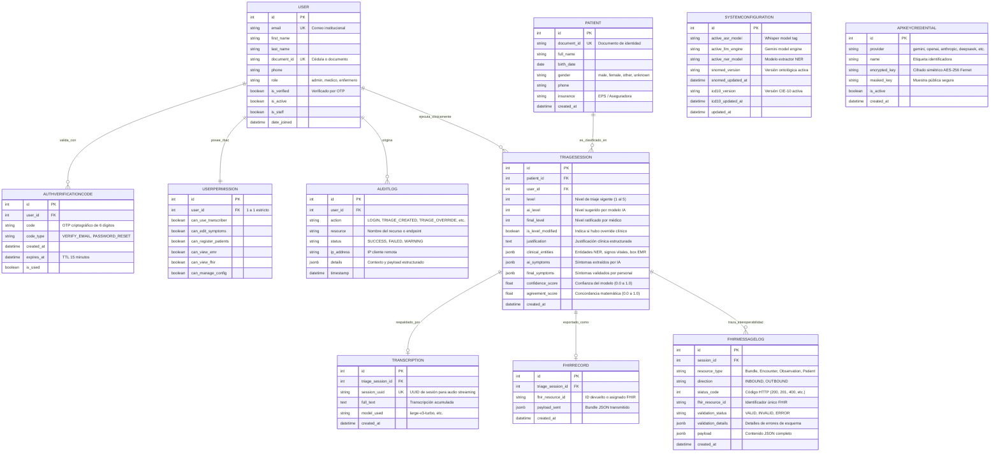

# Modelo de Datos Implementado (AI-Triage)

**Fecha de Actualización:** 2026-09-10  
**Motor de Persistencia:** PostgreSQL 16 (Producción) / SQLite (Test Suite)  
**ORM:** Django 5.2.8 / Django REST Framework  

---

## 1. Diagrama de Entidad-Relación (Mermaid)

---

## 2. Descripción y Justificación de las Entidades

### 2.1. Dominio de Cuentas y Seguridad (`accounts`)
1. **`User`**:
   - Reemplaza el modelo base de Django. Define el correo institucional y `document_id` como identificadores únicos. Añade el rol asistencial (`role`) y estado de verificación médica (`is_verified`).
2. **`AuthVerificationCode`**:
   - Almacena códigos OTP numéricos de 6 dígitos generados criptográficamente para activación de cuenta y reseteo de contraseñas. Controla expiración temporal (TTL de 15 minutos) y previene reuso mediante bandera `is_used`.
3. **`UserPermission`**:
   - Matriz de permisos RBAC granulares asociados a cada usuario en relación uno a uno. Controla de forma individual el acceso al transcriptor de voz, edición de síntomas, admisión de pacientes, EMR, monitor FHIR y panel de configuración.
4. **`AuditLog`**:
   - Registro inmutable de eventos críticos de seguridad y auditoría clínica (`LOGIN`, `TRIAGE_CREATED`, `TRIAGE_OVERRIDE`, `PERMISSIONS_UPDATED`, `KEY_REGISTERED`, `CONFIG_UPDATED`, `EMR_BOX_ASSIGNED`) con persistencia de IP cliente y metadatos JSON.

### 2.2. Dominio de Pacientes (`patients`)
1. **`Patient`**:
   - Contiene la información demográfica fundamental. El campo `document_id` posee restricción de unicidad estricta para evitar duplicidad de historias clínicas en urgencias.

### 2.3. Dominio Clínico de Triaje (`triage`)
1. **`TriageSession`**:
   - Entidad núcleo del flujo clínico. Desacopla la sugerencia del modelo (`ai_level`, `ai_symptoms`) del dictamen humano (`final_level`, `final_symptoms`), registrando si existió override (`is_level_modified`) y computando el índice matemático de concordancia (`agreement_score`). En `clinical_entities` se almacenan signos vitales normalizados y asignación física de box de urgencias (`box_assigned`).
2. **`Transcription`**:
   - Vinculada a la sesión de triaje. Guarda el texto consolidado y el `session_uuid` utilizado por el motor acústico ASR (`faster-whisper`) para streaming y reensamblado de audio.
3. **`FHIRRecord`**:
   - Registro del recurso HL7/FHIR exportado hacia el servidor de interoperabilidad clínica.
4. **`FHIRMessageLog`**:
   - Bitácora de transacciones FHIR R4 entrantes y salientes con trazabilidad de código de estado HTTP, validez estructural del payload y detalle de fallos de conformidad.

### 2.4. Dominio de Configuración del Sistema (`system_settings`)
1. **`SystemConfiguration`**:
   - Parámetros dinámicos del sistema: motores de inferencia activos (ASR, LLM, NER) y versiones de las terminologías clínicas (SNOMED-CT y CIE-10).
2. **`APIKeyCredential`**:
   - Bóveda de credenciales de proveedores de IA (`gemini`, `openai`, `anthropic`, `deepseek`, `groq`, `cohere`, `mistral`). Las claves se cifran en reposo con AES-256 (Fernet) derivado de la clave secreta del sistema; nunca se devuelven en texto plano y se sincronizan automáticamente con variables de entorno `.env`.

---

## 3. Índices Compuestos y Optimización

Para garantizar rendimiento hospitalario en escenarios de alta concurrencia, el modelo implementa los siguientes índices relacionales:

- `accounts.User`: Índices únicos sobre `email` y `document_id`.
- `accounts.AuditLog`: Índice compuesto sobre `('user', '-timestamp')` y sobre `('action', '-timestamp')`.
- `patients.Patient`: Índice único en `document_id` e índice sobre `full_name`.
- `triage.TriageSession`: Índice compuesto sobre `('patient', '-created_at')` e índice sobre `('-created_at', 'level')`.
- `triage.FHIRMessageLog`: Índice compuesto sobre `('session', '-created_at')` y sobre `('validation_status', '-created_at')`.
